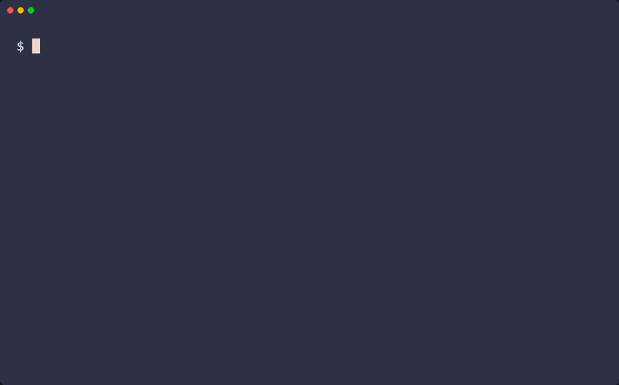
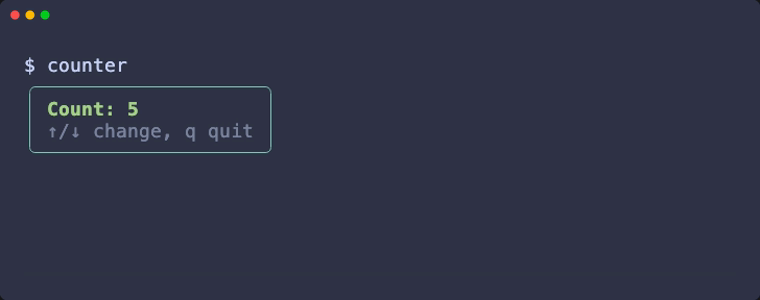
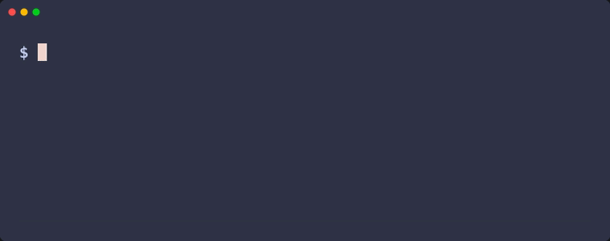

# Stipple

SwiftUI for the terminal. A Swift port of [Ink](https://github.com/vadimdemedes/ink),
with the SwiftUI API you already know.

<p>
  <a href="https://github.com/telip007/stipple/actions/workflows/ci.yml"></a>
  
  
  <a href="LICENSE"></a>
</p>

<p align="center">
  
</p>

- **SwiftUI-shaped API:** `View`, `@ViewBuilder`, `VStack`/`HStack`, modifiers,
  `@State`, `@Environment`, `.onKeyPress`. No flexbox, no React.
- **Ink's runtime behaviour:** inline rendering below the shell prompt, `Static`
  scrollback, throttled frames, raw-mode input, focus with Tab, optional
  alternate screen, plain output in CI and pipes.
- **Never leaves your terminal broken:** raw mode, cursor and alternate screen
  are restored on exit, on error and on crash.
- **Swift 6, strict concurrency**, on macOS and Linux.

> [!NOTE]
> **Early development.** The API is taking shape and will change before 1.0.
> While on `0.x`, minor releases may contain breaking changes.

## Installation

```swift
// Package.swift
dependencies: [
    .package(url: "https://github.com/telip007/stipple.git", from: "0.3.1"), // x-release-please-version
],
targets: [
    .executableTarget(name: "MyTool", dependencies: [
        .product(name: "Stipple", package: "stipple"),
    ]),
]
```

Requires Swift 6.2+ and macOS 15 or Linux.

## Quick start

```swift
import Stipple

struct Counter: View {
    @State private var count = 0
    @Environment(\.exit) private var exit

    var body: some View {
        VStack(alignment: .leading) {
            Text("Count: \(count)").foregroundStyle(.green).bold()
            Text("↑/↓ change, q quit").dim()
        }
        .padding(.horizontal, 1)
        .border(.rounded, color: .cyan)
        .onKeyPress(.upArrow) {
            count += 1
            return .handled
        }
        .onKeyPress(.downArrow) {
            count -= 1
            return .handled
        }
        .onKeyPress("q") {
            exit()
            return .handled
        }
    }
}

try await Stipple.run(Counter())
```



The examples in this README are compiled and run by
`Tests/StippleTests/ReadmeExampleTests.swift`, so they cannot drift from the API.

## Examples

Three runnable examples live in [`Examples/`](Examples). Clone the repository and
run them with `swift run <name>`. The recordings are scripted with
[VHS](https://github.com/charmbracelet/vhs) (`make demos`).

### Counter: state and key handling

`swift run counter`



[Watch in higher quality](.github/assets/demos/counter.mp4)

### Tasks: `Static` scrollback and a spinner

`swift run tasks`

Finished tasks scroll into the terminal's history with `Static` while a
`ProgressView` spinner and progress bar show the running one.


[Watch in higher quality](.github/assets/demos/tasks.mp4) · [Still](.github/assets/demos/tasks.png)

### Chat: a REPL with a live input line

`swift run chat`

A `TextField` with `.onSubmit`, bracketed paste and a real terminal cursor
(so input methods work). Sent messages move into scrollback.


[Watch in higher quality](.github/assets/demos/chat.mp4) · [Still](.github/assets/demos/chat.png)

## Components

Beyond the layout primitives, Stipple ships the pieces Ink apps usually pull
from separate packages:

| View | What | Ink ecosystem |
| --- | --- | --- |
| `TextField("Name", text: $name)`, `SecureField` | Single-line input with cursor, word and line editing, paste, `.onSubmit` | ink-text-input |
| `ProgressView()`, `ProgressView("Loading")` | Spinner (`.progressViewStyle(.dots / .line / .arc)`) | ink-spinner |
| `ProgressView(value: 0.4)` | Progress bar that fills the offered width | ink-progress-bar |
| `SelectionList(items, selection: $selected) { … }` | Arrow-key list with scrolling and Enter to submit; click selects, double-click submits | ink-select-input |
| `ScrollView { … }` | Vertical scrolling with a scroll indicator, `.scrollPosition($position)`, `.defaultScrollAnchor(.bottom)` for chat-style pinning, Page Up/Down and the mouse wheel | |
| `Divider()` | A line across the enclosing stack | |

```swift
struct Login: View {
    @State private var user = ""
    @State private var password = ""
    @FocusState private var field: Field?
    enum Field { case user, password }

    var body: some View {
        VStack(alignment: .leading) {
            HStack {
                Text("User:     ")
                TextField("name", text: $user).focused($field, equals: .user)
            }
            HStack {
                Text("Password: ")
                SecureField("secret", text: $password).focused($field, equals: .password)
            }
        }
        .onSubmit { field = field == .user ? .password : nil }
        .onAppear { field = .user }
    }
}
```

A transcript that follows new messages while you are at the bottom, and stays
put when you scroll up to read:

```swift
struct Transcript: View {
    let messages: [String]
    @State private var position = ScrollPosition(edge: .bottom)

    var body: some View {
        ScrollView {
            ForEach(messages, id: \.self) { Text($0) }
        }
        .defaultScrollAnchor(.bottom)
        .scrollPosition($position)
        .scrollOnPageKeys()
    }
}
```

`position.edge == .bottom` says whether it is pinned, and
`position.scrollTo(edge: .bottom)` jumps back. Turn on
`RenderOptions.mouseReporting` for the mouse wheel, click-to-focus,
`.onTapGesture` and `.onHover`.

## Coming from Ink

| Ink | Stipple |
| --- | --- |
| `render(<App/>)` | `try await Stipple.run(App())` |
| `<Box flexDirection="column">` | `VStack`, `HStack`, `ZStack` |
| `<Text color="green" bold>` | `Text("…").foregroundStyle(.green).bold()` |
| `padding`, `borderStyle` | `.padding()`, `.border(.rounded)` |
| `<Static items={…}>` | `Static(items) { item in … }` |
| `useInput` | `.onKeyPress(_:action:)` |
| `useApp().exit` | `@Environment(\.exit)` |
| `useFocus` | `.focusable()`, `@FocusState`; Tab cycles |
| `useState` | `@State` |

The complete mapping is in the
[architecture page](wiki/concepts/architecture.md#ink--stipple-api-map).
Stipple ports Ink's behaviour, not its API.

## Coming from SwiftUI

Stipple mirrors SwiftUI's names and layout model, with these differences:

- **Cells, not points.** One unit is one terminal cell. Sizes, padding and
  spacing are whole numbers of columns and rows.
- **Keyboard first, mouse opt-in.** Input is the keyboard (`onKeyPress`,
  `onPaste`) and pasted text. With `RenderOptions.mouseReporting` the wheel
  scrolls the `ScrollView` under the pointer, and on the alternate screen a
  click focuses the view under it, `.onTapGesture(count:)` sees clicks,
  `.onHover` sees the pointer, and a `SelectionList` row selects on click and
  submits on double-click. Other gestures (drag, long press) don't exist. While it is on,
  terminals need Shift (Option in some macOS terminals) held to select text.
- **Scrolling is vertical and row-based.** `ScrollView` scrolls by rows;
  `ScrollPosition` takes `scrollTo(edge:)`, `scrollTo(y:)`, `scrollTo(id:)` and
  `scrollBy(lines:)`. A position at an edge stays there as content grows.
  Scroll views take ↑/↓, Page Up/Down and Home/End while focus is in or on
  them; `.scrollOnPageKeys()` lets Page Up/Down through from elsewhere.
- **Focus moves with Tab and Shift-Tab.** `.focusable()` views join the cycle;
  `@FocusState` reads and sets it.
- **Inline by default.** The view renders below the shell prompt and leaves its
  last frame in scrollback. Use `RenderOptions.alternateScreen` for full-screen apps.
- **Text only.** Colours are ANSI, 256-colour or truecolor, reduced to what the
  terminal supports (detected like chalk, or set `RenderOptions.colorDepth`);
  borders are box-drawing characters. There are no images or custom drawing.

## Contributing

See [CONTRIBUTING.md](CONTRIBUTING.md). In short: `make bootstrap`, then `make check`
before you push. Design notes, decisions and known gotchas live in the
[project wiki](wiki/index.md).

## License

[Apache 2.0](LICENSE). See [NOTICE](NOTICE) for third-party attribution.

## Acknowledgements

Stipple exists because of [Ink](https://github.com/vadimdemedes/ink) by
[Vadim Demedes](https://github.com/vadimdemedes) (MIT). Its rendering, input and
output behaviour is the reference this library ports. Stipple is an independent
project and is not affiliated with or endorsed by Ink or its authors.
